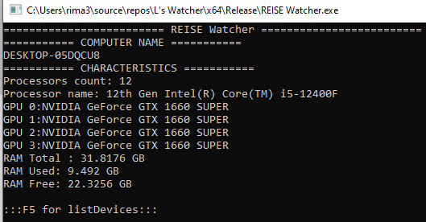

# REISE Watcher – Windows System Information Tool

A lightweight, dependency-free system information utility written in C++ and WinAPI.

## Features
- **CPU**: Name, core count
- **GPU**: All display devices
- **RAM**: Total, used, free (GB)
- **Devices**: List all connected hardware with optional class filter (USB, Display, etc.)

## Build
Open `.sln` in Visual Studio, compile as Release x64. No external libraries required.

## Technologies
- WinAPI (Registry, System Info, Memory Status)
- SetupAPI (Device Enumeration)
- Unicode support via `_setmode` and `WCHAR_TO_STRING`

## Author
**Moiyper** – 16 y.o. C++ Developer  
GitHub: [@Moiyper](https://github.com/Moiyper)

## License
MIT